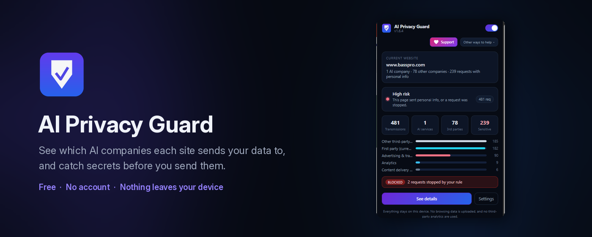
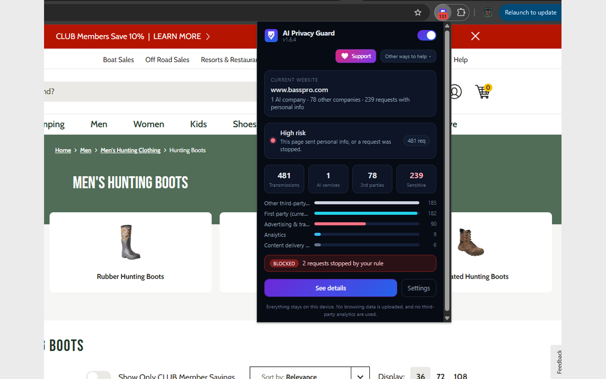
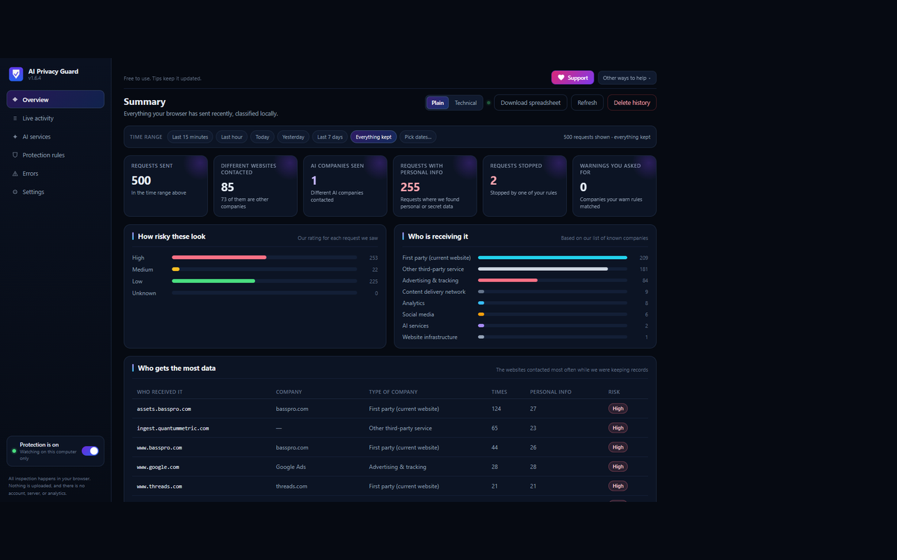
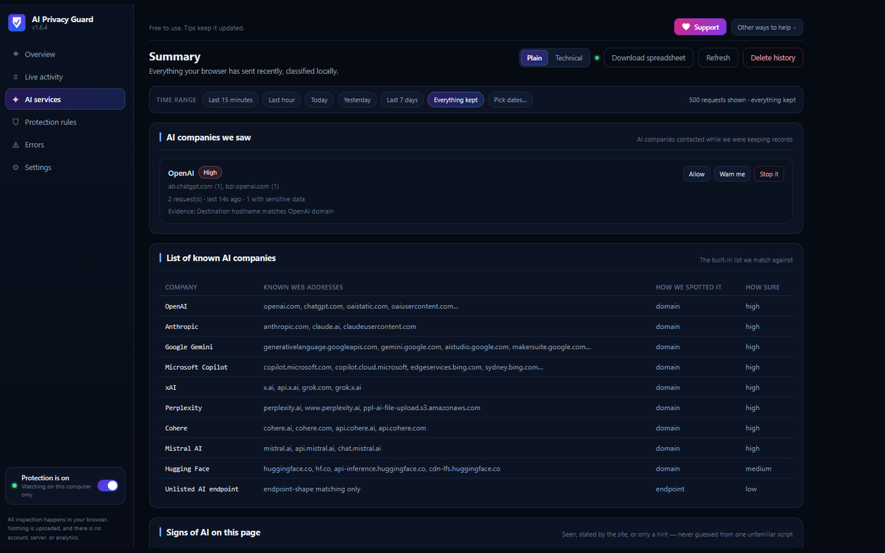

# AI Privacy Guard

See which AI companies each site sends your data to, and catch secrets before you send them.

A free Chrome extension by J Bongo. No account. Nothing leaves your device.

## What it does

- Watches the requests each page makes, and shows which AI companies and third parties that page contacted.
- Flags requests that look like they carry personal data.
- Lets you set a block or warn rule for a destination.
- Shows at most one alert per page.
- Before a form submit, or Enter to send in a chat, checks for API keys, passwords, emails, card numbers, and ID numbers. You can cancel, send anyway, or redact them with placeholders like `[EMAIL_ADDRESS_1]`.

## Private by design

All of this runs on your device.

- No account
- No servers
- No analytics
- The extension makes no network requests of its own

## Honest limits

- It shows what was sent. It cannot stop a request mid-load. Blocking applies from then on.
- It cannot see a site forward your data to an AI company from that site's own servers. "No AI detected" is not a guarantee.
- Pre-send checks cover form submit and Enter only. They do not cover paste, or a click on a Send button, yet.
- It cannot read responses or WebSocket messages.

## Screenshots

**Toolbar popup.** The current site, who it contacted, and a rule that stopped requests.

**Overview.** A local summary of recent requests: how risky they looked, and who received them.

**AI companies.** Services the extension recognized, and any that showed up while records were kept.

## Install

**Chrome Web Store: coming soon.**

The listing is not live yet. When it is, the install link will be added here.

## Report a bug / get help

- [Open an issue](https://github.com/JpBongiovanni/ai-privacy-guard/issues)
- [Discord](https://discord.gg/DU9SZ7BkeK)
- Email [thebongobongo228@gmail.com](mailto:thebongobongo228@gmail.com)

Please include your Chrome version, the extension version, the site you were on, and what happened.

## Privacy policy

[Privacy policy](https://jpbongiovanni.github.io/ai-privacy-guard/privacy-policy.html)

The same page is also served at [the site root](https://jpbongiovanni.github.io/ai-privacy-guard/).

## Support the project

A tip is optional and unlocks nothing.

- [Tip](https://streamelements.com/j_bongo/tip)
- [YouTube](https://youtube.com/@JBongoGamer)
- [X](https://x.com/JBongoGamer)
